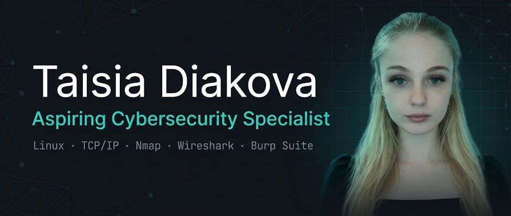

### Hi there, I'm Taisia 👋🏻 👩🏼

I'm an aspiring cybersecurity specialist looking for my first role. I'm passionate about learning how security tools work and prefer practicing in virtual machines because of their simplicity and user-friendliness. I'm currently working with popular tools such as Wireshark for traffic analysis, Nmap for port and vulnerability scanning, and Burp Suite for web security testing and write-ups. I'd love to gain hands-on work experience and grow in this field. ✨

### 📜 About me
- 🎯 Target roles: SOC Analyst L1 · Technical Support L1/L2 · Junior Security Specialist
- 🛠️ Core skills: Linux, TCP/IP, DNS/HTTP, Nmap, Wireshark, Burp Suite

### 🧪 Practical Labs & Projects *(in progress)*
- [`network-recon-lab`](https://github.com/taisiadiakova/network-recon-lab) — Nmap port scanning & risk assessment report
- [`pcap-traffic-investigation`](https://github.com/taisiadiakova/pcap-traffic-investigation) — Wireshark traffic analysis & anomaly hunting
- web-security-writeups — PortSwigger & Burp Suite vulnerability write-ups *(coming soon)*

### 📜 Key Certifications
- [Google Cybersecurity Certificate](https://www.coursera.org/account/accomplishments/verify/9QQSB49WNANQ)
- [Cisco NetAcad — Badge 1](https://www.credly.com/badges/0b3b53e2-ba68-463e-8465-e2b1bc9c1167)
- [Cisco NetAcad — Badge 2](https://www.credly.com/badges/2214b7e6-ee3c-43bc-ab78-7d10c170452d)

### 🌎 Socials
<a href=https://www.linkedin.com/in/таїсія-д-якова-75397520b/>LinkedIn</a> 

